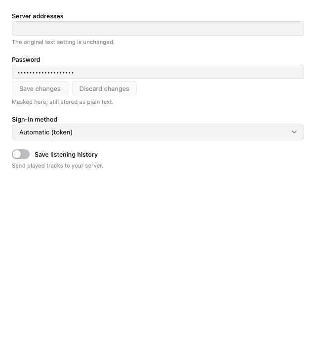
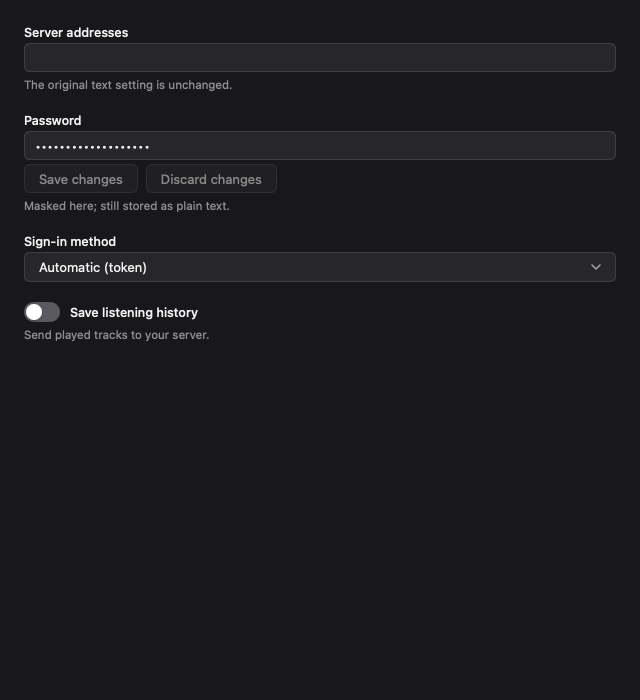

# Optional plugin setting controls

Reference branch: [`TexasOct/mygo-music:feat/plugin-setting-types`](https://github.com/TexasOct/mygo-music/tree/feat/plugin-setting-types).

Based on official commit `93bf5a6202119305bc36fa7b1da71402c96e6879` (MyGo Music 0.1.18). This is an issue proposal and runnable reference implementation, not an accepted upstream API or a released app binary.

## Problem

Plugin settings currently share one text editor. A listener must type `true` for a boolean or memorize an authentication method, and passwords are visible. This appeared while implementing the [Subsonic source](https://github.com/TexasOct/mygo-subsonic).

## Small additive schema

```json
{
  "settings": [
    { "key": "password", "label": "Password", "type": "password" },
    { "key": "history", "label": "Save listening history", "type": "boolean" },
    {
      "key": "authMode", "label": "Sign-in method", "type": "select",
      "options": [
        { "value": "", "label": "Automatic (token)" },
        { "value": "token", "label": "Token" },
        { "value": "legacy", "label": "Legacy password" }
      ]
    }
  ]
}
```

Plugin code is unchanged:

```js
const password = host.setting("password");
const historyEnabled = host.setting("history") === "true";
const authMode = host.setting("authMode") || "token";
```

| Metadata | Editor and value semantics |
| --- | --- |
| Missing type, `text` or an unknown type | Original text field; keeps submit/blur saving. |
| `password` | Masked input, including its accessibility value; explicit Save/Discard so typing, Enter and blur do not persist partial credentials. |
| `boolean` | Switch; writes string `"true"` or `"false"`. Empty shows off without writing a default. Other saved values fall back to text. |
| `select` | Displays labels and saves string values. Blank and unlisted values are preserved; only selecting a declared option changes storage. Invalid/ambiguous options fall back to text. |

`key`, `label`, `help` and `link` retain their meanings. Option labels use the existing plugin locale file; keys and values are not translated. Opening settings does not migrate or write anything. `host.setting(key)`, `setSetting({key, value})` and the on-disk string map are unchanged.

Older official hosts ignore the extra metadata and still show text fields. Plugins must retain useful text-entry help. A manifest example is available on the Subsonic plugin's separate [`feat/optional-setting-types` branch](https://github.com/TexasOct/mygo-subsonic/blob/feat/optional-setting-types/plugin.json); its stable release remains independent of this proposal.

## Implementation

- [`internal/music/music.go`](internal/music/music.go): optional `Type`, `Options` and value/label pairs.
- [`internal/app/ui_source_settings.go`](internal/app/ui_source_settings.go): native controls and source/key-scoped draft state.
- [`internal/app/ui_settings.go`](internal/app/ui_settings.go): shared save completion, ordered per-source UI writes and pending-value tracking for legacy text fields.
- [`internal/plugin/plugin.go`](internal/plugin/plugin.go): clone and translate option labels without changing the manifest.
- [`internal/app/ui_source_settings_test.go`](internal/app/ui_source_settings_test.go): real input, failed-save retry/restore, write ordering, legacy queued edits, accessibility and screenshot fixtures.
- [`internal/plugin/plugin_test.go`](internal/plugin/plugin_test.go): option translation does not change persisted values or the original manifest.

Switch/select changes save once and disable their own control while pending. Failure keeps a retryable draft; Discard restores the prior successful value through the source when a failed write already changed memory. UI saves are serialized per source because the current plugin writer persists a whole map to one temporary file. Queued text values are tracked to prevent repeated blur writes or losing a subsequent undo.

## Validation

```sh
go test ./internal/...
go test ./internal/app -run '^TestTypedSetting' -count=5
mkdir -p /tmp/mygo-setting-frames
MM_FRAMES=/tmp/mygo-setting-frames go test ./internal/app -run '^TestTypedSettingFrames$' -count=1
```

The full internal suite and repeated new UI tests pass. Headless screenshots were inspected at 640/1000 px in light/dark themes. The Subsonic branch passes its 52 Node HTTP integration tests and strict TypeScript checks, and its actual plugin executes under pristine official MyGo 0.1.13, where the additional metadata is ignored.

### Screenshots

Synthetic values only; no real account is shown.





## Boundaries and questions

- Password masking is **not encryption**. Settings remain plaintext JSON; no keychain or secret-storage API is added.
- No custom forms, arrays, account manager, default-value migration, credential protocol changes or new plugin runtime APIs are included.
- Save serialization covers UI-initiated writes, not arbitrary future callers outside that path.
- The UI was exercised with the real headless renderer; no signed desktop build is distributed here.

Is this small optional schema appropriate for upstream? In particular, would you prefer another type spelling or save interaction? The reference branch is provided for discussion and reuse; no pull request is being opened.
